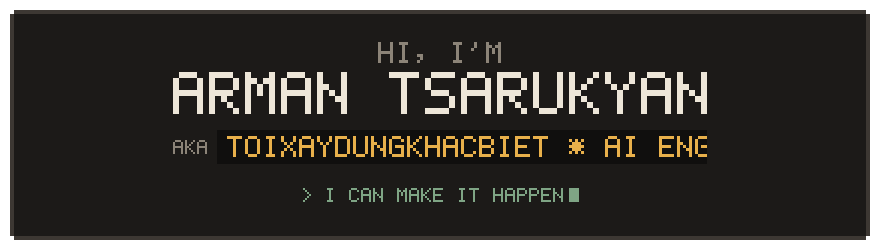
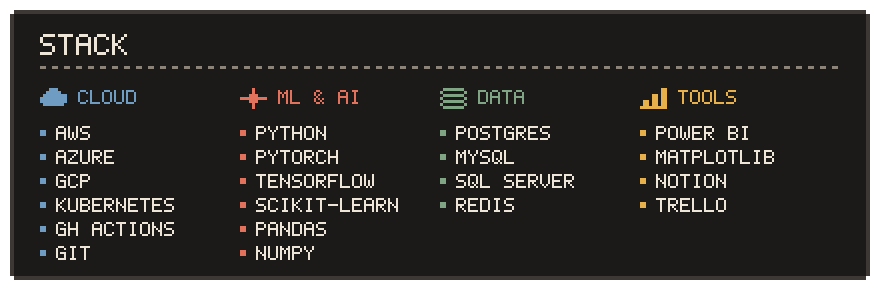
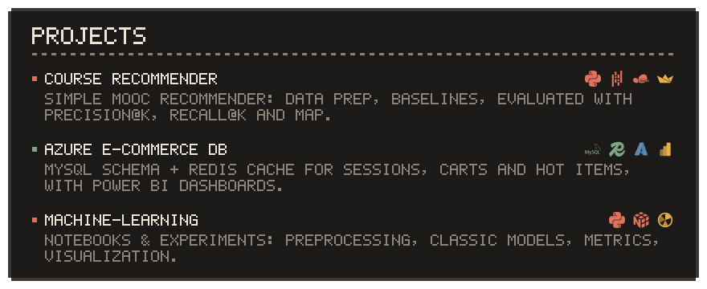

  

  

  

  

  
    <a href="https://github.com/KhangPhanTZ/course-recommender-simple">course recommender</a> ·
    <a href="https://github.com/KhangPhanTZ/azure-ecommerce-DB">azure e-commerce db</a> ·
    <a href="https://github.com/KhangPhanTZ/Machine-learning">machine-learning</a>
  

